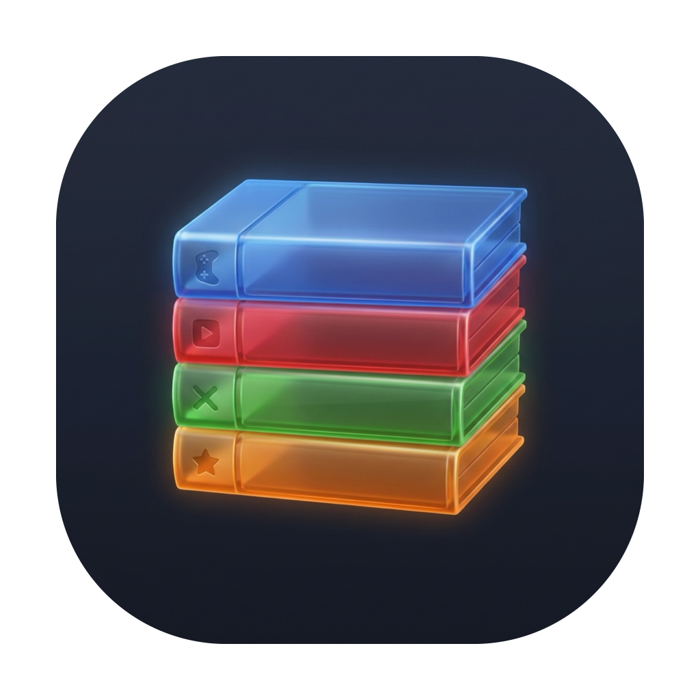
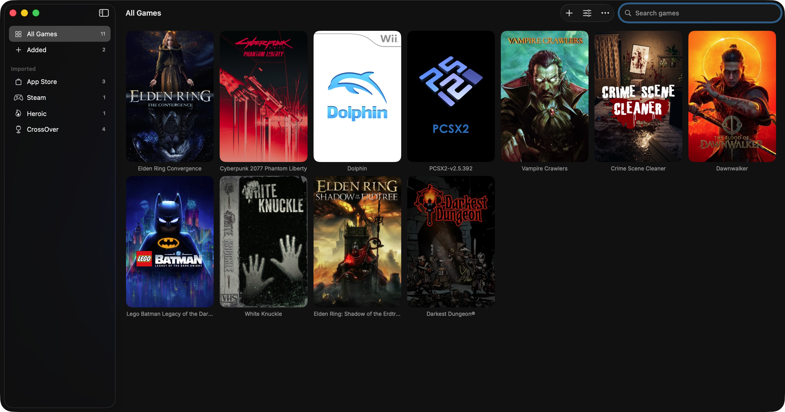

<p align="center">
  
</p>

<h1 align="center">Cabinet</h1>

<p align="center">
  A native macOS game library for the games and launchers already on your Mac.
</p>

<p align="center">
  
  
  
</p>

Cabinet gathers installed games into one browsable shelf. Its interface uses SwiftUI and AppKit, with a native macOS sidebar, toolbar, search, settings, and appearance controls.

## What it does

- Finds Mac applications and games, installed Steam titles, Heroic library entries, and CrossOver launchers.
- Lets you add custom launch commands, edit game details, and hide entries without removing them.
- Filters by source, searches the library, and adjusts poster size and grid columns.
- Downloads covers from SteamGridDB, uses locally cached Steam artwork, and accepts custom covers and logos.
- Plays animated covers through cached AVFoundation video, pauses offscreen playback, and respects Reduce Motion.
- Uses Steam, Heroic, app, or shell launch routes, with a choice of what Cabinet does after a game starts.
- Follows the system appearance or uses a chosen light or dark theme.

## Screenshot

<p align="center">
  
</p>

This is a screenshot of Cabinet running on macOS. Library discovery reads local application and launcher metadata, then lets you browse and launch the entries it finds.

## Build

**Requirements:** macOS 14 or newer, Xcode 15 or newer, and an Apple Silicon Mac.

```sh
git clone https://github.com/NerdBaba/Cabinet.git
cd Cabinet
swift test
./script/build_and_run.sh
```

The build script creates `../Cabinet.app`, signs it locally for development, and opens it. Use `./script/build_and_run.sh --build-only` to create the app without opening it. The project has no remote Swift package dependencies. A small WebP decoder is bundled for one-time animation preparation; see `Vendor/WebP/README.md` and `Resources/WebP-LICENSE.txt`.

## SteamGridDB artwork

Set an API key in **Settings → Cover Art** to fetch covers. Cabinet stores the key in its local settings and sends it to SteamGridDB for API requests. Steam's own cached covers work without a key.

## Local data

Cabinet keeps its game catalog, preferences, cover art, and prepared animation cache under:

```text
~/Library/Application Support/dev.cartridges.swift.rebuild/
```

The storage identifier preserves the existing Cabinet installation's library when updating the app.
